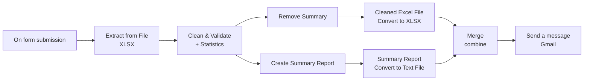

# Excel Data Cleaning & Validation Workflow (n8n)

An n8n automation that accepts an Excel file through a web form, cleans and validates the data, calculates summary statistics, and emails the user a **cleaned Excel file** together with a **summary report**.

---

## Overview

Manually cleaning spreadsheets is slow and error-prone. This workflow automates the entire process:

1. A user uploads an `.xlsx` file through an n8n form.
2. The workflow reads every row of the file.
3. A code node cleans and validates the data and computes statistics.
4. The workflow splits into two parallel branches:
   - one produces the cleaned Excel file,
   - the other produces a plain-text summary report.
5. Both files are merged and sent in a single email through Gmail.

---

## Workflow Architecture

---

## Nodes

| # | Node | Type | Purpose |
|---|------|------|---------|
| 1 | **On form submission** | Form Trigger | Receives the uploaded `.xlsx` file from the user. |
| 2 | **Extract from File** | Extract From File (XLSX) | Reads the spreadsheet and outputs one item per row. |
| 3 | **Clean & Validate + Statistics** | Code | Cleans each row, validates values, and calculates dataset statistics. |
| 4 | **Remove Summary** | Code | Strips the summary/statistics data so only clean rows remain. |
| 5 | **Cleaned Excel File** | Convert to File (XLSX) | Converts the clean rows into a downloadable `.xlsx` file. |
| 6 | **Create Summary Report** | Code | Builds the text content of the summary report from the statistics. |
| 7 | **Summary Report** | Convert to File (Text) | Converts the report into a `.txt` file. |
| 8 | **Merge** | Merge (Combine) | Combines both files into one item so they can be sent together. |
| 9 | **Send a message** | Gmail (Send: Message) | Emails both files as attachments. |

---

## How It Works

### 1. Intake
The **Form Trigger** exposes a public form with a file upload field. When a user submits the form, the workflow starts with the uploaded spreadsheet as binary data.

### 2. Extraction
**Extract from File** parses the XLSX and converts each spreadsheet row into an n8n item, so the rest of the workflow can process rows as structured JSON.

### 3. Clean, Validate and Analyse
The **Clean & Validate + Statistics** code node is the core of the workflow. It processes the extracted rows, applies the cleaning and validation rules, and produces summary statistics for the dataset.

### 4. Parallel Output Branches
After the code node, the workflow splits in two:

- **Cleaned data branch:** `Remove Summary` keeps only the clean data rows, and `Cleaned Excel File` converts them into an `.xlsx` file.
- **Report branch:** `Create Summary Report` builds the report text, and `Summary Report` converts it into a `.txt` file.

### 5. Merge and Deliver
**Merge** combines both branches (Input 1 = cleaned Excel, Input 2 = summary report), and the **Gmail** node sends one email with both files attached.

---

## Prerequisites

- An n8n instance (self-hosted or n8n Cloud)
- A Google account with Gmail access
- A Gmail OAuth2 credential configured in n8n

---

## Setup

1. **Import the workflow**
   - In n8n, go to **Workflows → Import from File** and select the workflow JSON file.

2. **Configure Gmail credentials**
   - Open the **Send a message** node.
   - Create or select a **Gmail OAuth2** credential and authorise your Google account.

3. **Set the email recipient**
   - In the **Send a message** node, enter the recipient address (or map it to a form field if you add an email field to the form).

4. **Check the attachments**
   - Make sure both binary files (the cleaned `.xlsx` and the summary `.txt`) are selected as attachments in the Gmail node.

5. **Activate the workflow**
   - Toggle the workflow to **Active** so the production form URL becomes available.

---

## Usage

1. Open the form URL from the **On form submission** node.
2. Upload an `.xlsx` file.
3. Submit the form.
4. Check the recipient inbox for an email containing:
   - `cleaned file (.xlsx)`: the validated, cleaned dataset
   - `summary report (.txt)`: statistics and validation results

---

## Example Output

The email contains two attachments:

| Attachment | Format | Content |
|------------|--------|---------|
| Cleaned Excel File | `.xlsx` | The cleaned and validated rows |
| Summary Report | `.txt` | Dataset statistics and validation summary |

---

## Customisation

- **Change the cleaning rules:** edit the JavaScript in the **Clean & Validate + Statistics** node (for example trimming whitespace, removing duplicates, fixing formats, or flagging invalid values).
- **Change the report layout:** edit the **Create Summary Report** code node.
- **Change the delivery channel:** replace the Gmail node with Slack, Telegram, Outlook, or Google Drive.
- **Collect the recipient from the form:** add an email field to the form and reference it in the Gmail node's *To* field.

---

## Tech Stack

- [n8n](https://n8n.io/) workflow automation
- JavaScript (Code nodes)
- Gmail API (OAuth2)
- XLSX / plain-text file conversion

---

## Limitations

- Only `.xlsx` files are supported by the extraction step.
- Very large spreadsheets may need extra memory on the n8n instance.
- Cleaning rules are defined in code, so any change in the expected column structure requires updating the Code nodes.

---

## License

This project is released under the MIT License. Feel free to use and adapt it.
